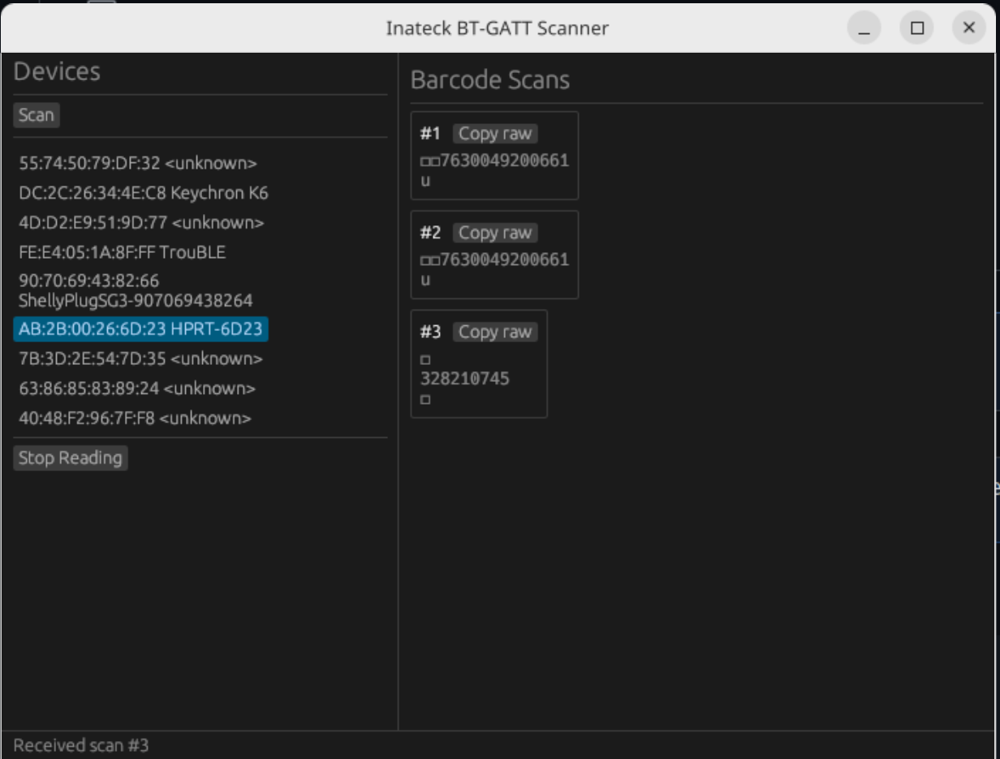

# inateck-bt-gatt

Read Inateck/HPRT barcode scanners via BLE GATT, bypassing HID keyboard input. Parses ISO/IEC 15434 Format 06 barcodes (Digi-Key, Mouser) and copies raw data to clipboard for direct use with Part-DB, InvenTree, or PartsBox.



## Requirements

- Linux with BlueZ
- Scanner in **Expert mode** (not HID keyboard mode)
- `libdbus` development headers (`apt install libdbus-1-dev`)

## Usage

```bash
just gui                                         # GUI application
just cli scan                                    # Find nearby BLE devices
just cli discover -a AB:2B:00:26:6D:23           # List GATT services
just cli read -a AB:2B:00:26:6D:23 -C            # Read barcodes, copy to clipboard
just cli read -a AB:2B:00:26:6D:23 -C --hex      # With hex dump
just build                                       # Build release binaries
```

## Workspace

| Crate | Description |
|-------|-------------|
| `crates/lib` | Library: BLE helpers (BlueZ/D-Bus) + ISO 15434 barcode parser |
| `crates/cli` | CLI: scan, discover, read subcommands |
| `crates/gui` | GUI: egui app with device list, live scan display, clipboard |
